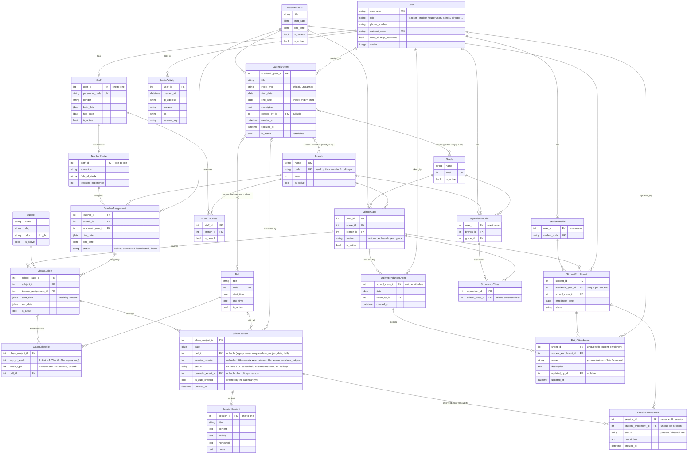
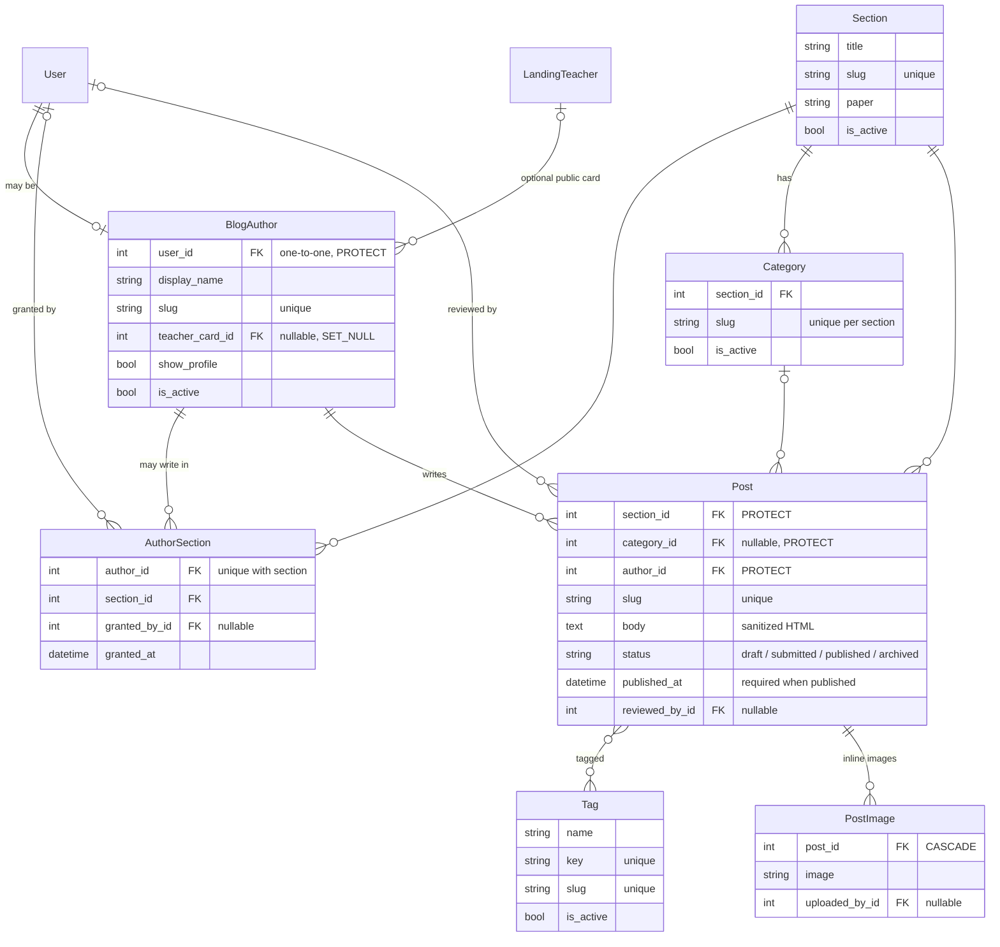

# Database ER Diagram

The school-domain tables and their relations, as Mermaid. Prose descriptions of each model are in [database.md](database.md); the academic calendar's rules are in [apps/academic_calendar.md](apps/academic_calendar.md).

* Dates (`jdate`) are `django_jalali` `jDateField`s: stored in Gregorian, shown in Jalali.
* The website CMS tables (`website` app: site settings, landing page, menus, contact page, contact messages, about page and teachers page) and Django's own tables are left out. The contact, about and teachers tables are described in [database.md](database.md#public-website-contact-page); their links into the school domain are `ContactLocation.branch` → `Branch`, `AboutPerson.staff` → `Staff` and `LandingTeacher.teacher` → `TeacherProfile` (all optional, `SET_NULL`).
* Every table also has an `id` primary key (not repeated below except where it helps).
* The blog's tables (`blog` app) are drawn separately at the end: they link into the domain through `BlogAuthor.user` → `User` and the optional `BlogAuthor.teacher_card` → `LandingTeacher`.

## Blog

| Table | Constraint | Meaning |
| --- | --- | --- |
| `Post` | `blog_published_post_has_date` | `status = 'published'` ⇒ `published_at IS NOT NULL` |
| `Category` | `blog_unique_category_slug_per_section` | one slug per section |
| `AuthorSection` | `blog_unique_author_section` | one grant per author and section |

## Academic calendar constraints at a glance

| Table | Constraint | Meaning |
| --- | --- | --- |
| `CalendarEvent` | `calendar_event_end_after_start` | `end_date >= start_date` |
| `SchoolSession` | `unique_session_number_per_class_subject` | numbers are unique per class subject (NULLs never collide) |
| `SchoolSession` | `unique_session_per_slot` | one session per `(class_subject, date, bell)` when `bell` is set |
| `SchoolSession` | `session_number_only_when_counted` | `status = 'HL'` ⇔ `session_number IS NULL` |

## Attendance constraints at a glance

| Table | Constraint | Meaning |
| --- | --- | --- |
| `DailyAttendanceSheet` | `unique_daily_attendance_sheet_per_class_day` | one sheet per `(school_class, date)` |
| `DailyAttendance` | `unique_daily_attendance_per_sheet` | one record per `(sheet, student_enrollment)` |
| `SessionAttendance` | `unique_attendance_per_session` | one record per `(session, student_enrollment)`; table `attendance_attendance` (archive, read-only) |
